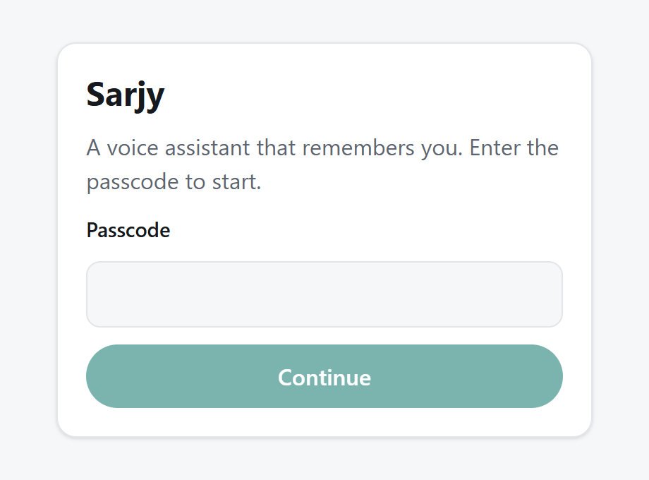
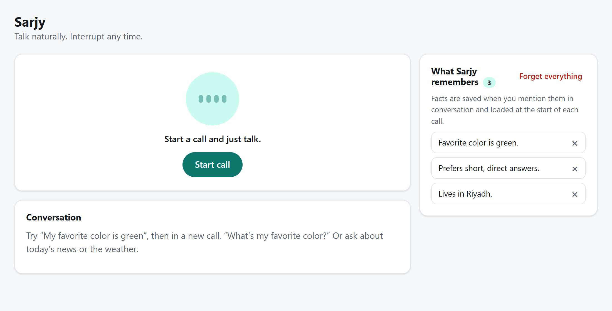

# Sarjy user guide

Sarjy is a voice assistant that runs in your browser. You talk to it the way you would talk to a person: it answers out loud, you can interrupt it at any time, it remembers what you tell it about yourself from one conversation to the next, and it can look up anything current on the web.

This guide covers getting in, holding a conversation, how memory works, and a short script for demonstrating all of it.

## What you need

- A recent version of Chrome, Edge, Safari or Firefox, on a computer or a phone.
- A microphone and speakers. Headphones give the best results, because the assistant never hears its own voice.
- The site address and the passcode.
- A secure connection. Browsers only allow microphone access over HTTPS, or on `localhost` when running Sarjy on your own machine (`http://localhost:8000`).

## Getting in

Open the site and enter the passcode, then select **Continue**.

Entering the passcode gives this browser its own private memory. Sarjy keeps you signed in on this browser, so you only need the passcode once. Another browser or device starts with an empty memory.

After five wrong attempts, the passcode screen locks for 15 minutes.

## The main screen

- **Call controls (top left).** The circle shows what Sarjy is doing, with a status line underneath. **Start call** begins a conversation and becomes **End call** while one is running.
- **Conversation (bottom left).** A live transcript of the call: what you said, what Sarjy said, and a small label whenever Sarjy saves a fact or searches the web.
- **What Sarjy remembers (right).** Every fact Sarjy has saved about you, newest first. On a phone, this panel moves below the conversation.

## Having a conversation

1. Select **Start call**.
2. The first time, your browser asks for permission to use the microphone. Choose **Allow**.
3. When the status reads **Listening**, just talk. There is no button to hold and no wake word.
4. Sarjy replies out loud, and the transcript fills in as you both speak.
5. Select **End call** when you are done.

The status line tells you where things stand:

| Status | Meaning |
|---|---|
| Connecting… | The call is being set up. This takes a second or two. |
| Listening | Sarjy is waiting for you to speak. |
| Hearing you… | Sarjy can hear you talking. |
| Thinking… | You have finished speaking and Sarjy is preparing a reply, or running a search. |
| Speaking | Sarjy is answering. |

**Interrupting.** You can talk over Sarjy at any point. It stops speaking straight away and listens to you, just like in a normal conversation. This is useful when an answer runs long or goes in the wrong direction.

**Reply delay.** After your first exchange, a line under the button shows how long Sarjy took to start answering, measured from the moment you stopped speaking to the first sound of its reply.

**Languages.** Sarjy answers in the language you speak to it. English and Arabic both work.

## Teaching Sarjy about you

Mention something about yourself and Sarjy saves it, without being asked. For example:

- "My favorite color is green."
- "I live in Riyadh."
- "I'm vegetarian."
- "Keep your answers short."

When it saves a fact, a label such as *Saved: Favorite color is green.* appears in the transcript, and the fact shows up in the memory panel.

Facts are loaded at the start of every call, so in a later conversation Sarjy already knows them. Ask "What's my favorite color?" and it answers right away. It also uses what it knows without being asked: a restaurant suggestion takes your diet into account, and a weather question uses your city.

**Correcting a fact.** Just say the new version, for example "Actually, my favorite color is blue now." Sarjy updates the existing fact instead of keeping both, and the transcript shows *Updated: …*.

**Making Sarjy forget.** You can do this by voice or on screen:

- Say "Forget where I live." The transcript shows *Forgot a fact*.
- Select the **×** next to a fact in the memory panel to delete it.
- Select **Forget everything** to clear the whole memory, after confirming.

Deleting from the panel takes effect immediately, even in the middle of a call. Sarjy is told about it and stops using the fact.

Sarjy saves things worth remembering about you, such as preferences, personal details, people in your life and plans. Avoid telling it anything you wouldn't want written down, such as passwords or card numbers.

## Asking about current things

Sarjy searches the web when a question needs recent or specific information, for example:

- "What's the weather like today?"
- "What's in the news this morning?"
- "Who won the match last night?"
- "Is the Louvre open on Mondays?"

It says something like "Let me check" first, because a search takes a few seconds. The transcript shows *Searching: …* while the search runs, then *Searched: …* with how long it took. Sarjy then gives a short spoken answer and may mention where the information came from.

Questions that don't need fresh information, such as explanations, advice or general knowledge, are answered directly without a search.

## A three-minute demo

This script shows voice, memory and web search in one short session. Start with an empty memory, using **Forget everything** if needed.

**Call 1: teach it**

1. Select **Start call** and allow the microphone.
2. Say: "Hi! My name is Sam, my favorite color is green, and I live in Riyadh."
    - Three *Saved* labels appear and the memory panel fills in.
3. Ask a long question, such as "Tell me about the history of coffee", then interrupt halfway with "Okay, that's enough, thanks."
    - Sarjy stops mid-sentence and responds to you.
4. Select **End call**.

**Call 2: it remembers**

5. Select **Start call** again. This is a completely new conversation.
6. Ask: "What's my favorite color?"
    - Sarjy answers "green" straight away, with no search and no tool label.
7. Ask: "Do I need an umbrella today?"
    - Sarjy says "Let me check", searches for the weather in Riyadh (the city it remembered), and answers.
8. Say: "Actually, my favorite color is blue now."
    - The transcript shows *Updated*, and the fact changes in place in the panel.
9. In the memory panel, select **×** next to the city, then ask "Where do I live?"
    - Sarjy says it doesn't know.
10. Select **End call**. The reply-delay line shows how quickly Sarjy responded during the call.

## Troubleshooting

| What you see | What to do |
|---|---|
| "Microphone access was denied." | Allow the microphone for this site in the browser's address bar or site settings, then start the call again. |
| "No microphone was found." | Connect a microphone, or check that the operating system allows the browser to use it. |
| No sound from Sarjy | Check the volume and the output device, then end the call and start a new one. |
| Sarjy talks to itself or interrupts itself | It is hearing its own voice through your speakers. Use headphones or turn the volume down. |
| "The upstream service failed." when starting a call | The server could not reach the voice service. Try again in a moment; if it persists, the server's OpenAI key needs checking. |
| "Daily call limit reached. Try again tomorrow." | Each user can start 50 calls a day. |
| "Too many searches. Wait a minute and try again." | Each user can run 10 searches a minute. |
| "Too many attempts. Try again in 15 minutes." | Too many wrong passcodes were entered from your network. |
| The memory panel is empty on another device | Memory belongs to the browser where you entered the passcode. |

## Privacy

- **Stored on the Sarjy server:** the facts in your memory panel and an anonymous ID for your browser. No name, email or account is needed.
- **Not stored:** your voice and the call transcript. Audio streams directly between your browser and OpenAI's voice service, and the transcript disappears when you leave the page.
- **Deleting:** **Forget everything** permanently deletes all your facts from the server.
